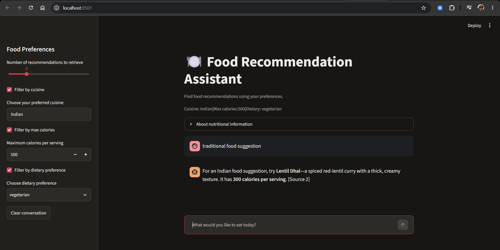
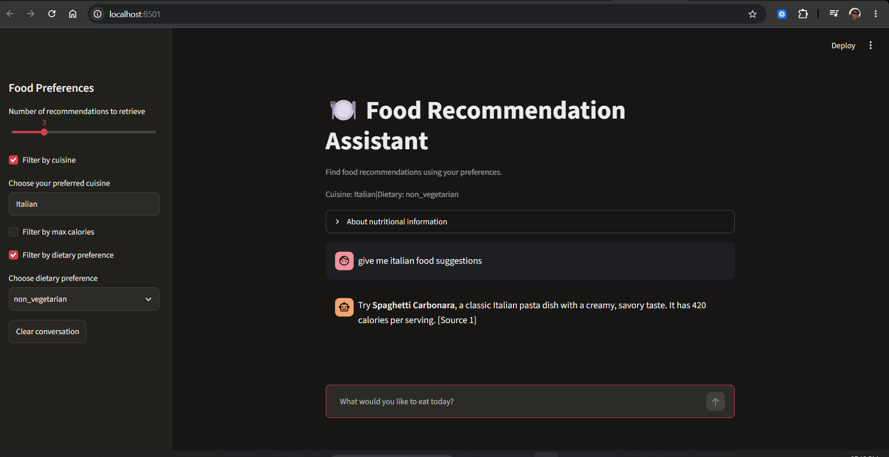
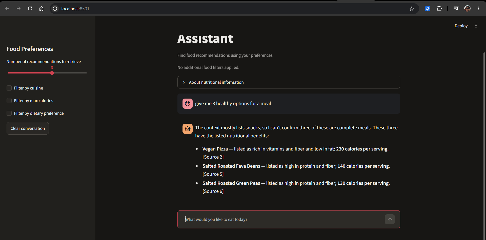
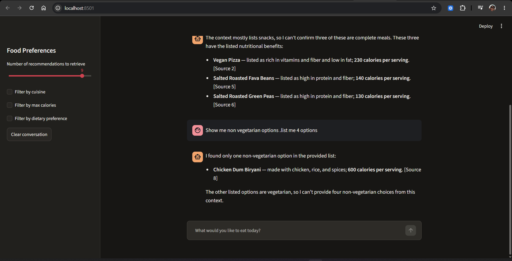
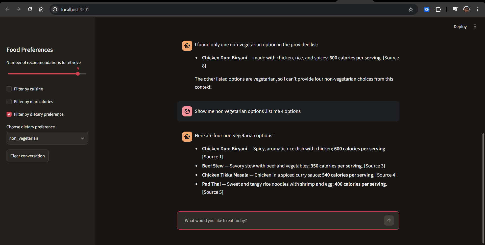
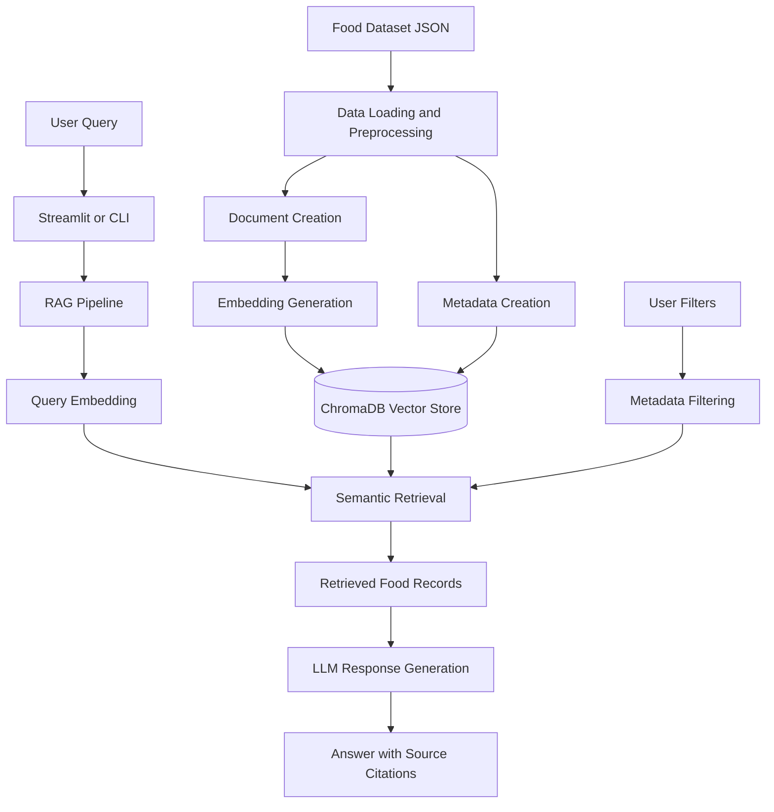
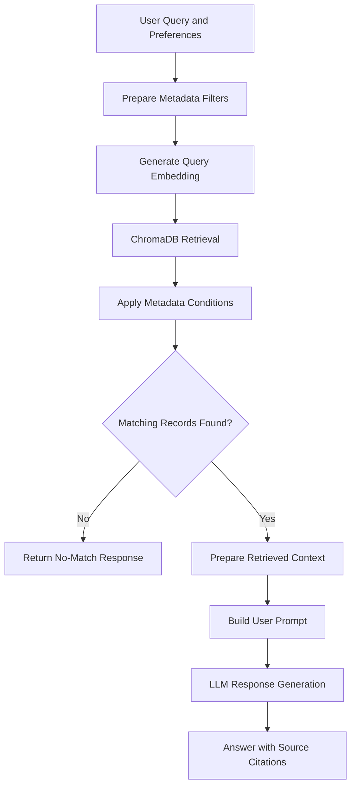

# Interactive Food Search and RAG Chatbot System

A **Vanilla Retrieval-Augmented Generation (RAG)** application that allows users to search a food dataset using natural-language queries and receive recommendations generated from retrieved food records.

The project combines semantic search, ChromaDB, metadata filtering, and an OpenAI chat model to provide food recommendations based on user queries and preferences.

## Live Demo

**Live Application:** [Open Food Recommendation Assistant](YOUR_DEPLOYED_APP_URL)


## Application Screenshots

### 1. Search with all filters

Search using cuisine, maximum calories, and dietary preference together.



### 2. Italian cuisine filtering

Retrieve food recommendations using a cuisine preference.



### 3. General food search

Ask for recommendations without applying additional metadata filters.



### 4. Non-vegetarian query without a dietary filter

This example shows that semantic search alone may return vegetarian records even when the user requests non-vegetarian food.



### 5. Non-vegetarian query with a dietary filter

After enabling the non-vegetarian metadata filter, the system retrieves matching recommendations.




## Features

- Natural-language food search using semantic similarity.
- Cuisine-based filtering.
- Maximum calorie filtering.
- Vegetarian and non-vegetarian filtering.
- Combined metadata filtering.
- LLM-generated responses based on retrieved food records.
- Source citations in generated recommendations.
- Local and OpenAI embedding support.
- Persistent vector storage using ChromaDB.
- Streamlit chat interface.
- Command-line interface.
- Custom evaluation and embedding benchmark scripts.

## Architecture

### 1. Overall RAG workflow



### 2. Retrieval and generation



### How retrieval works

The project uses two approaches together:

**Semantic search**

The user query is converted into an embedding and compared with food records stored in ChromaDB. This helps find records based on the meaning of the query.

**Metadata filtering**

Structured filters can restrict results using fields such as:

- `cuisine_type`
- `calories`
- `dietary_type`

For example, when a user requests Indian vegetarian food under 500 calories, the system applies the selected metadata conditions along with semantic retrieval.

Semantic similarity alone does not guarantee that every result satisfies a specific requirement. Metadata filtering helps enforce these structured conditions.

## Technology Stack

| Component             | Technology                  |
| --------------------- | --------------------------- |
| Programming language  | Python                      |
| LLM                   | OpenAI Chat Completions API |
| Local embeddings      | all-MiniLM-L6-v2            |
| OpenAI embeddings     | text-embedding-3-small      |
| Vector database       | ChromaDB                    |
| User interface        | Streamlit                   |
| Configuration         | python-dotenv               |
| Architecture diagrams | Mermaid                     |
| Evaluation            | Custom Python scripts       |

## Project Structure

```text
02-rag-food-recommendation-system/
│
├── data/
│   └── food_dataset.json
│
├── docs/
│   ├── screenshots/
│   │   ├── 01-query-with-all-filters.png
│   │   ├── 02-query-with-Italian-filter.png
│   │   ├── 03-general-query-without-any-filters.png
│   │   ├── 04-non_veg-query-without-filter.png
│   │   └── 05-non_veg-query-with-non_veg-filter.png
│   │
│   ├── benchmark-results.md
│   ├── engineering_lessons.md
│   └── evaluation_results.md
│
├── scripts/
│   ├── benchmark_embeddings.py
│   ├── evaluate_rag.py
│   ├── ingest.py
│   └── test_retriever.py
│
├── src/
│   ├── config.py
│   ├── data_loader.py
│   ├── embeddings.py
│   ├── logging_config.py
│   ├── prompts.py
│   ├── rag_pipeline.py
│   ├── retriever.py
│   └── vector_store.py
│
├── app.py
├── main.py
├── requirements.txt
├── .env.example
├── .gitignore
└── README.md
```

## Installation and Setup

### 1. Clone the repository

```bash
git clone https://github.com/jaskaranjjk97/rag-lab.git
cd rag-lab/02-rag-food-recommendation-system
```

### 2. Create a virtual environment

```bash
python -m venv .venv
```

Activate it on Windows:

```powershell
.venv\Scripts\Activate.ps1
```

### 3. Install dependencies

```bash
pip install -r requirements.txt
```

### 4. Configure environment variables

Create a `.env` file in the project root. Use `.env.example` as a reference.

```env
OPENAI_API_KEY=your_openai_api_key_here

# Chat model
OPENAI_MODEL=your_chat_model_name

# Number of retrieved records
TOP_K=3

# Embedding configuration
# Supported providers: local, openai
EMBEDDING_PROVIDER=local

LOCAL_EMBEDDING_MODEL=all-MiniLM-L6-v2
EMBEDDING_MODEL=text-embedding-3-small
```

To use local embeddings:

```env
EMBEDDING_PROVIDER=local
```

To use OpenAI embeddings:

```env
EMBEDDING_PROVIDER=openai
```

An OpenAI API key is required for LLM generation. It is also required when OpenAI embeddings are selected.

**Important:** Do not upload your actual `.env` file or API key to GitHub.

## Running the Application

### Streamlit application

```bash
streamlit run app.py
```

The Streamlit interface allows users to:

- Enter natural-language food queries.
- Select the number of recommendations to retrieve.
- Enable cuisine filtering.
- Set a maximum calorie limit.
- Select a dietary preference.
- View generated recommendations with source citations.

### Command-line interface

```bash
python main.py
```

The CLI provides another way to search for food recommendations and apply filters.

## Data Ingestion

The project separates data ingestion from user-query retrieval.

To run the ingestion script:

```bash
python -m scripts.ingest
```

The ingestion workflow prepares the food records, generates embeddings, and stores them in ChromaDB.

## Evaluation

The project includes a custom evaluation script for checking the main retrieval and generation features.

Run:

```bash
python -m scripts.evaluate_rag
```

### Latest evaluation result

\<badge>7/7 tests passed\</badge>

| Test                         | Result         |
| ---------------------------- | -------------- |
| Semantic retrieval relevance | PASS           |
| Indian cuisine filtering     | PASS           |
| Maximum calorie filtering    | PASS           |
| Dietary type filtering       | PASS           |
| Combined metadata filtering  | PASS           |
| Duplicate record detection   | PASS           |
| LLM generation and citations | PASS           |
| **Total**                    | **7/7 passed** |

### Latest observed end-to-end test timing

| Metric              |       Result |
| ------------------- | -----------: |
| Retrieved documents |            3 |
| Retrieval time      | 4.77 seconds |
| LLM generation time | 3.60 seconds |
| Total request time  | 8.38 seconds |

These timings are from one execution and should not be treated as benchmark averages.

See [Evaluation Results](docs/evaluation_results.md) for the evaluation report.

## Embedding Benchmark

The project compares two embedding models:

- **Local:** all-MiniLM-L6-v2 — 384 dimensions.
- **OpenAI:** text-embedding-3-small — 1536 dimensions.

### Benchmark summary

| Metric                         | Local MiniLM |   OpenAI |
| ------------------------------ | -----------: | -------: |
| First-query latency            |    16.7406 s | 4.7627 s |
| Average warm retrieval latency |     0.0444 s | 0.3891 s |
| Average Precision\@5           |         0.40 |     0.70 |
| Average Recall\@5              |         0.54 |     0.94 |

The benchmark used:

- 179 prepared food records.
- Four manually labelled queries.
- Three warm repetitions per query.
- Top-K retrieval of 5.

In this experiment, local MiniLM provided faster warm retrieval, while OpenAI embeddings achieved higher precision and recall.

These results are preliminary. The query set is small and manually labelled, so they do not prove that one model is generally better than the other.

See [Embedding Benchmark Results](docs/benchmark-results.md) for the full results and limitations.

## Engineering Lessons

While building this project, I encountered several practical issues involving data preparation, ChromaDB, metadata filtering, Python environments, and testing.

Some important lessons were:

- Semantic similarity does not guarantee that retrieved records satisfy structured requirements.
- Multiple metadata filters must be combined correctly.
- Duplicate IDs need to be handled before indexing.
- Function return values should follow a consistent order.
- Library APIs should be checked against the installed version.
- Tests should verify the actual expected behaviour.
- Ingestion and retrieval are easier to maintain when kept separate.

Read [Engineering Lessons & Troubleshooting](docs/engineering_lessons.md) for the problems, fixes, and lessons in detail.

## Limitations

- Recommendations depend on the information available in the food dataset.
- Some food records have incomplete or ambiguous ingredient information.
- Dietary classifications are not verified allergen-safety guarantees.
- The evaluation suite checks core functionality but does not prove every generated statement is correct.
- The embedding benchmark uses a small manually labelled query set.

## Future Improvements

- Add more food records.
- Expand the retrieval evaluation dataset.
- Explore hybrid retrieval and reranking.
- Improve the quality and validation of food metadata.

---

**Author:** Jaskaran Singh

**GitHub Repository:** [rag-lab](https://github.com/jaskaranjjk97/rag-lab)
